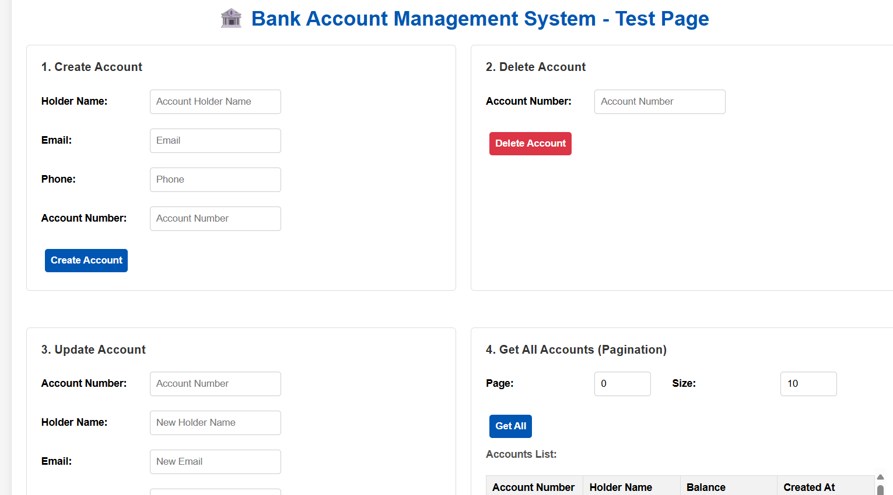

# Bank Account Management Service

A RESTful banking service built with Java 17 and Spring Boot for managing bank accounts with comprehensive features including account operations, fund transfers, and data management.

## Core Function
- Create bank accounts with holder information
- Delete bank accounts
- Update account details (holder name, email, phone)
- List all accounts with pagination support
- View specific account details
- transfer funds between accounts

## Features
- Balance validation and insufficient fund protection
- H2 in-memory database for development
- Caching for improved performance
- Comprehensive input validation
- Robust error handling with structured responses
- Pagination for efficient data retrieval

## Technologies

- Java 17
- Spring Boot 3.5.6
- Spring Data JPA
- H2 Database
- Maven
- Docker

## Deployment

### Prerequisites
- Java 17 or higher
- Maven 3.6+ (for building)
- Docker (optional)

### Build and Run

#### Option 1: Using Maven
```bash
# Build the project
./mvnw clean package

# Run the application
./mvnw spring-boot:run

# Run with sample data
./mvnw spring-boot:run -Dspring-boot.run.profiles=dev
```

#### Option 2: Using JAR file
```bash
# Build first
./mvnw clean package

# Run the JAR
java -jar target/bankAccount-management-service-0.0.1-SNAPSHOT.jar

# Run with sample data (insert some data to test)
java -jar target/bankAccount-management-service-0.0.1-SNAPSHOT.jar --spring.profiles.active=dev
```

#### Option 3: Using Docker
```bash

# Build Docker image  packaged the jar in container
docker build -t bank-account-service .

# Run container
docker run -p 8080:8080 bank-account-service

# Run with sample data
docker run -p 8080:8080 -e SPRING_PROFILES_ACTIVE=dev bank-account-service
```

### Access Points
- API Base URL: http://localhost:8080/v1/accounts
- Health Check: http://localhost:8080/v1/accounts/health
- H2 Console: http://localhost:8080/h2-console
- Test Page: http://localhost:8080/index.html

#### H2 Console Configuration
- JDBC URL: `jdbc:h2:mem:bankdb`
- Username: `sa`
- Password: (leave empty)

## Testing

### Automated Tests
```bash
# Run all tests
./mvnw test

# Run specific test classes
./mvnw test -Dtest=AccountServiceTest
./mvnw test -Dtest=AccountControllerTest
./mvnw test -Dtest=AccountConcurrentTest
```

### Manual Testing

#### Option 1: Web Interface
I make a simple html to test the api
1. Start the application
2. Open http://localhost:8080/index.html in your browser
3. Use the web interface to test all API endpoints

#### Option 2: Command Line Testing(or postman)
I test in my windows using cmd

**Create Account:**
```cmd
curl -X POST http://localhost:8080/v1/accounts -H "Content-Type: application/json; charset=utf-8" -d "{\"accountNumber\": \"ACC001\", \"accountHolderName\": \"John Doe\", \"email\": \"john@example.com\", \"phone\": \"1234567890\", \"initialBalance\": 1000.00}"
```

**Delete Account:**
```cmd
curl -X DELETE http://localhost:8080/v1/accounts/ACC001
```

**Get All Accounts:**
```cmd
curl http://localhost:8080/v1/accounts?page=0^&size=10
```

**Get Account by Number:**
```cmd
curl http://localhost:8080/v1/accounts/ACC001
```

**Update Account:**
```cmd
curl -X PUT http://localhost:8080/v1/accounts/ACC001 -H "Content-Type: application/json" -d "{\"accountHolderName\": \"Jane Doe\", \"email\": \"jane@example.com\"}"
```

**Transfer Funds:**
```cmd
curl -X POST http://localhost:8080/v1/accounts/transfer -H "Content-Type: application/json" -d "{\"fromAccountNumber\": \"ACC001\", \"toAccountNumber\": \"ACC002\", \"amount\": 100.00}"
```

**Deposit:**
```cmd
curl -X POST "http://localhost:8080/v1/accounts/ACC001/deposit?amount=500.00"
```

**Withdraw:**
```cmd
curl -X POST "http://localhost:8080/v1/accounts/ACC001/withdraw?amount=200.00"
```

### Sample Data
When running with `dev` profile, the application initializes with sample accounts:
- ACC001 (张三) - Balance: 10,000.00
- ACC002 (李四) - Balance: 5,000.00
- ACC003 (王五) - Balance: 2,000.00
- ..

## API Endpoints

| Method | Endpoint | Description |
|--------|----------|-------------|
| POST | `/v1/accounts` | Create account |
| GET | `/v1/accounts` | List accounts (paginated) |
| GET | `/v1/accounts/{accountNumber}` | Get account details |
| PUT | `/v1/accounts/{accountNumber}` | Update account |
| DELETE | `/v1/accounts/{accountNumber}` | Delete account |
| POST | `/v1/accounts/transfer` | Transfer funds |
| POST | `/v1/accounts/{accountNumber}/deposit` | Deposit funds |
| POST | `/v1/accounts/{accountNumber}/withdraw` | Withdraw funds |
| GET | `/v1/accounts/health` | Health check |

## Error Handling

The service provides comprehensive error handling for:
- Account not found scenarios
- Insufficient balance for transfers/withdrawals
- Duplicate account creation attempts
- Invalid input validation
- Concurrent operation conflicts

All errors return structured JSON responses with appropriate HTTP status codes.